  

  
  &nbsp;
  

## Olá, eu sou Matheus Santos 👋

Estudo Engenharia de Software na FIAP e busco minha primeira oportunidade em tecnologia. Meus principais interesses são desenvolvimento Full-Stack e cibersegurança.

Antes do software, veio a elétrica: fiz o curso de Eletricista de Manutenção no SENAI e passei dois anos como Jovem Aprendiz na Bridgestone. Daí vem o "do circuito ao código", e também minha vontade de entender como as coisas funcionam de ponta a ponta.

- 🎓 Engenharia de Software na FIAP, com conclusão prevista para 2028
- 🖥️ Técnico em Informática pela ETIP
- 🔐 Cursos em cibersegurança, perícia forense e segurança de dados
- 🌎 Inglês avançado e espanhol básico

## 🧰 Tecnologias

  

Também trabalho com <b>SQL</b>, <b>Power BI</b>, <b>Dash</b> e <b>Plotly</b>.

## 🚀 Projetos em destaque

| Projeto | O que é | Tecnologias |
|---|---|---|
| **[Portfólio e dashboard de cibersegurança](https://github.com/MatheusSantos11/portfolio-pessoal)** · [ver site](https://portfolio-cybersec-dd5a.onrender.com/) | Portfólio interativo com dashboard sobre investimentos globais em cibersegurança. O site pode levar cerca de 1 minuto para abrir. | Python, Dash, Plotly, Pandas |
| **[Future Work](https://github.com/MatheusSantos11/Gs-Future-Work)** · [ver site](https://gs-future-work.vercel.app) | Aplicação sobre networking e futuro do trabalho, feita em equipe na FIAP. | React, TypeScript, Vite, Tailwind CSS |
| **[Estação Inteligente de Economia de Energia](https://github.com/MatheusSantos11/GS-Edge)** | Sistema IoT que usa sensores para ajudar a reduzir o desperdício de energia. | ESP32, MQTT, Node-RED, Python |
| **[Mentor de AppSec para agente de IA](https://github.com/MatheusSantos11/GuardAI-Agente-Inteligente-para-Ciberseguran-a-e-An-lise-de-Vulnerabilidades)** | Extensão que transforma um agente de IA em mentor de segurança de aplicações. | Python, SQLite |
| **[Passa a Bola](https://github.com/MatheusSantos11/sprint-4-passa-a-bola-arduino)** | Monitoramento em tempo real de passes e velocidade, com processamento na borda. | ESP32, MQTT, Node-RED, Flask |

<b>📜 Cursos e certificados</b>

 

- Google Associate Cloud Engineer (Alura)
- Desenvolvimento C# (Alura)
- Biohacking, Deep Web e Criptografia (FIAP)
- Cybersecurity Hacker Skills (FIAP)
- Cybersecurity (FIAP)
- Perícia Forense em Defesa Cibernética (FIAP)
- Segurança de Dados (FIAP)
- Ética na Inteligência Artificial (SENAI)

